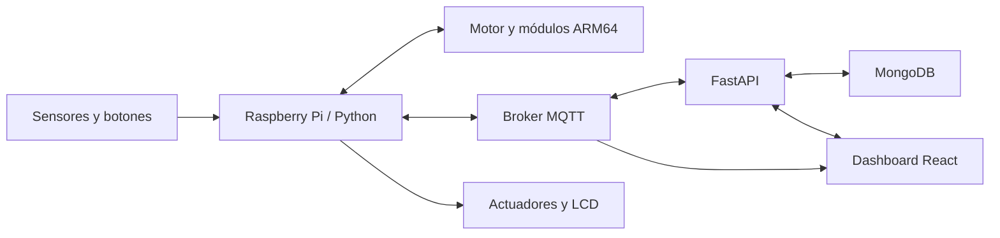

# Invernadero inteligente IoT · Grupo 17

Sistema académico de monitoreo y control de un invernadero de dos áreas. Integra una Raspberry Pi con sensores y actuadores, mensajería MQTT, una API FastAPI, persistencia en MongoDB, un panel React y rutinas de análisis escritas en ensamblador ARM64. Proyecto de Arquitectura de Computadores y Ensambladores 1 de la USAC.

## Qué hace

- Registra temperatura, humedad ambiental y del suelo, luminosidad y nivel de gas.
- Muestra lecturas, tendencias, eventos, comandos y análisis en un dashboard.
- Controla riego, iluminación, ventilación y alarma desde la web y botones físicos.
- Ejecuta análisis históricos y un motor ARM64 en vivo que emite decisiones de control. Python coordina el hardware y comunica los resultados.
- Admite datos simulados para explorar el flujo sin montar la maqueta.

## Arquitectura



La Raspberry Pi lee el hardware y publica datos por MQTT. El backend consume los mensajes, valida y guarda lecturas, estados y eventos en MongoDB, y ofrece una API REST. El panel consulta la API y recibe actualizaciones por MQTT sobre WebSocket. Para el análisis, Python prepara las entradas y ejecuta binarios AArch64; en el flujo en vivo interpreta su salida estructurada para aplicar acciones físicas. MongoDB puede estar en local o en Atlas mediante configuración.

## Recorrido por las fases

| Fase | Componentes | Propósito |
| --- | --- | --- |
| **1 · Análisis histórico** | [`arm64/fase1`](Proyecto1/arm64/fase1) | Cinco módulos en ensamblador procesan lecturas CSV: media ponderada, varianza, anomalías, predicción y tendencia. |
| **2 · Control y análisis integrado** | [`arm64/fase2`](Proyecto1/arm64/fase2), [`raspberry`](Proyecto1/raspberry) | Un motor ARM64 evalúa lecturas actuales y prioridades de actuación. Otros cinco módulos calculan RMSE, regresión lineal, predicción, integral del error y derivada local. El orquestador y el ejecutor Python conectan los resultados con GPIO, MQTT y la API. |
| **Sistema IoT y visualización** | [`backend`](Proyecto1/backend), [`frontend`](Proyecto1/frontend) | FastAPI recibe lecturas y comandos, MongoDB conserva el historial, MQTT distribuye eventos y React presenta estado y controles. |

### Fundamento del análisis

Las rutinas históricas convierten una serie de muestras en indicadores del ambiente. La **media ponderada** resume lecturas con distintos pesos; la **varianza** cuantifica dispersión; la **detección de anomalías** marca valores alejados del comportamiento esperado; la **predicción** estima valores futuros; y la **tendencia** describe la dirección de cambio.

La segunda fase añade medidas del comportamiento temporal y del error. El **RMSE** mide la distancia típica respecto de un valor ideal, la **regresión lineal** estima una pendiente, la **integral del error** acumula desviaciones en el tiempo y la **derivada local** detecta cambios recientes. El motor de decisiones en vivo emite campos como `ACTION`, `TARGET`, `RISK` y `REASON`; Python traduce la decisión en una acción del sistema.

## Estructura

```text
Proyecto1/
├── arm64/         # Ensamblador AArch64, Makefiles y lecturas de muestra
│   ├── fase1/     # Estadística histórica inicial
│   └── fase2/     # Motor en vivo y análisis histórico avanzado
├── backend/       # API FastAPI, MQTT, MongoDB y simulación
├── frontend/      # Dashboard React, Vite y Tailwind CSS
├── raspberry/     # Sensores, GPIO, LCD y ejecución de ARM64
├── docs/          # Informes, manual e imágenes de la maqueta
└── SETUP.md       # Instalación y flujos de ejecución detallados
```

## Probar el proyecto

**Requisitos:** Python 3.10+, Node.js 18+, pnpm y MongoDB. Para ejecutar ARM64 fuera de una Raspberry Pi se necesitan herramientas AArch64 y QEMU. El hardware y cableado están en [`wiring.md`](Proyecto1/raspberry/wiring.md).

1. Clona el repositorio y entra a `Proyecto1/backend`. Copia `.env.example` a `.env` y configura MongoDB y MQTT para tu entorno.
2. Crea un entorno virtual de Python e instala `pip install -r requirements.txt`.
3. Inicia la API con `python -m uvicorn app.main:app --host 127.0.0.1 --port 8000`. Su documentación queda en `http://localhost:8000/docs`.
4. En otra terminal, entra a `Proyecto1/frontend`, ejecuta `pnpm install` y `pnpm dev`, y abre `http://localhost:5173`. Si la API está en otra máquina, copia `frontend/.env.example` a `frontend/.env` y ajusta `VITE_API_BASE_URL`.
5. Para compilar las rutinas, entra a `Proyecto1/arm64` y ejecuta `make all`. La [guía completa](Proyecto1/SETUP.md) explica la simulación, los comandos de cada fase, el orquestador y las pruebas MQTT.

Los archivos `.env.example` contienen valores de desarrollo y marcadores de posición. Guarda credenciales reales solo en archivos `.env` ignorados por Git o en variables de entorno de tu instalación.

## Documentación

- [Puesta en marcha y modos de ejecución](Proyecto1/SETUP.md)
- [Informe técnico general](Proyecto1/docs/Informe%20Tecnico.md)
- [Manual del dashboard](Proyecto1/docs/Manual%20de%20Usuario%20.md)
- [Cableado de la Raspberry Pi](Proyecto1/raspberry/wiring.md)
- [Informes de los módulos](Proyecto1/docs)

## Alcance de seguridad

Este es un prototipo académico. La pantalla de acceso del frontend usa una credencial fija de demostración y **no autentica el backend**. La API de control y el broker público de ejemplo no deben exponerse a Internet ni conectarse a actuadores fuera de un entorno controlado sin añadir autenticación, autorización, transporte seguro e infraestructura MQTT privada. Ninguna contraseña real debe incluirse en variables `VITE_`, porque Vite las incorpora al código entregado al navegador.
